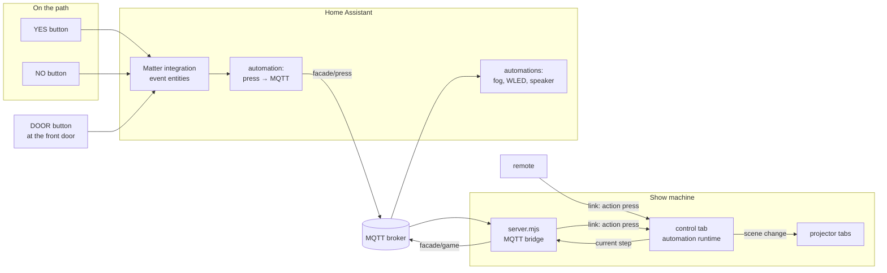
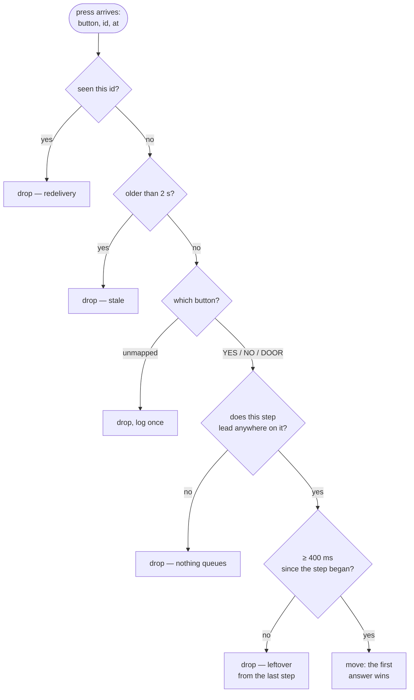

# Automation

> **Status: built.** Steps and the presses and timers between them, the rules
> for presses, the diagram and editor in the control tab, the **Automation**
> tab on the remote, and the MQTT bridge that brings in presses from Home
> Assistant all work. See [connecting the buttons](#getting-a-press-to-the-show).

An automation is a set of **steps**. Each step can:

- put a **scene** up on the house, or keep whatever is already on it;
- put **words** on the wall, written over whatever is up;
- play a **sound**;
- **alert** whoever is indoors, on the remote.

From each step, a **button** (YES, NO or DOOR) or a **timer** moves the show
to another step. That is the whole model: no ladders, levels or counters, so
what the diagram shows is exactly what will happen.

The buttons are Matter buttons in Home Assistant, and the house already has an
MQTT broker. Two or three are enough: YES and NO on the path, and DOOR at the
front door. The remote can press them too, and **Start again** puts the show
back to its first step from indoors whenever it is needed.

- [Trying it](#trying-it)
- [Steps](#steps)
- [The example](#the-example)
- [The shape of it](#the-shape-of-it)
- [Handling presses](#handling-presses)
- [Getting a press to the show](#getting-a-press-to-the-show)
- [Telling the rest of the house](#telling-the-rest-of-the-house)
- [What it does to the rest of the show](#what-it-does-to-the-rest-of-the-show)
- [Starting again from clean](#starting-again-from-clean)
- [Building it](#building-it)

## Trying it

1. Trace the house and tag the **wall**, the **door** and the **windows**. Tag a
   flat panel **primary** for the words, and the area just above a hanging
   basket or window box **planter** (or **basket**, **pot**, **flowers**) for
   flowers.
2. Open the **Automation** panel in the control tab and press **Build the
   example**.
3. Press **Open the editor**. Each box is a step, showing the words it puts on
   the wall; each arrow is a button or a timer. Click a step and the side shows
   everything about it:
   - **On the house**: the scene it shows, or *keep what is on*. Tick the
     effects the scene shows right there, or make a scene from what is on the
     wall now.
   - **Words on the wall**: written over whatever is up. A new line is a new
     line on the wall.
   - **Then**: where YES, NO and DOOR lead, and after how many seconds it
     moves on by itself, and to where.
   - **Also**: a sound, and whether to alert you indoors.
4. Play it with the YES / NO / DOOR buttons in the panel or the editor.
   **↺ Start again** goes back to the start step at once.
5. Run it from indoors with the remote's **Automation** tab
   (`remote.html#game`). Turn on 🔔 **Sound**, ⚡ **Flash** and 📳 **Buzz** to
   be told every time it moves on. A step marked as an alert rings a doorbell
   and puts its name up in a blue banner on the remote, whichever tab it is
   showing: that is the moment to get up with the sweets.

The diagram is drawn from the steps themselves
([`js/core/game.js`](../js/core/game.js)), so an arrow on it is a move the show
will make, and a press with no arrow is a press it will drop.

## Steps

| Field | What it does |
| --- | --- |
| **Name** | What the editor, the remote and Home Assistant call it. |
| **Scene** | Put up when the step starts, with the scene's own fade. Empty keeps the house as the step before left it. |
| **Words** | Written on the automation's text layer, over whatever is up. A step can change only the words. |
| **YES / NO / DOOR** | The step each button leads to. A button with nothing set is ignored on this step. |
| **After … s → step** | Moves on by itself after this long. Empty: it waits for a button. |
| **Sound** | An uploaded sound, played as the step starts. |
| **Alert** | The remote rings and flashes, and shows the step's name until it moves on. |

One step is the **start**: where the show waits, and where **Start again**
goes. The diagram lays the steps out from it, left to right, one column per
move. A timer that leads back to the start is not drawn as an arrow (every
unanswered question would be one) but noted on the box: *↺ to the start after
2 min*.

The editor lists what is wrong under the diagram: a step that leads to a
deleted step, a scene that no longer exists, a dead end the show would stop
at, a step nothing leads to, or a button a step listens for that no physical
button is mapped to.

## The example

Thirteen steps, built from your tagged shapes:

| Step | Shows | Says | Then |
| --- | --- | --- | --- |
| Trick or treat? | The house: brick, fog, flowers | TRICK OR TREAT? YES FOR A TRICK | YES → Lightning and smoke · NO → Did you say trick? |
| Did you say trick? | (as it was) | DID YOU SAY… TRICK? | YES → Lightning and smoke · NO → But we love to scare |
| But we love to scare | (as it was) | BUT WE LOVE TO SCARE… | YES → Lightning and smoke · NO → Come and get your treat |
| Lightning and smoke | Lightning, smoke | | after 6 s → Scared yet? |
| Scared yet? | Smoke | SCARED YET? | NO → Flowers die, creature · YES → Come and get your treat |
| Flowers die, creature | The flowers die, a creature at the windows | | after 7 s → Scared yet? (again) |
| Scared yet? (again) | (as it was) | SCARED YET? | NO → Tentacles · YES → Come and get your treat |
| Tentacles | Tentacles from the walls, blood down the door | | after 8 s → Out of tricks |
| Out of tricks | (as it was) | WE'RE ALL OUT OF TRICKS. COME AND GET YOUR TREAT. | DOOR → At the door |
| Come and get your treat | (as it was) | COME AND GET YOUR TREAT. | DOOR → At the door |
| At the door | Everything at once | | after 10 s → Sweets |
| Sweets | Candles, the door glowing | | after 30 s → Happy Halloween |
| Happy Halloween | Fireworks | HAPPY HALLOWEEN! | after 8 s → Trick or treat? |

Every question goes back to *Trick or treat?* after two minutes with nothing
pressed. *Come and get your treat*, *Out of tricks* and *At the door* alert
indoors.

The house keeps what each scare reveals: the flowers that die stay dead, and
the creature is still at the window when the tentacles come. *Scared yet?* the
second time and *Come and get your treat* change only the words, so they are
asked over whatever the group has seen so far.

**Where people stand decides what goes on the wall.** The YES and NO buttons
sit far enough back that the whole facade is in view and words on it can be
read. At the door they are too close to read anything on the house, so the
steps there are sound, light and something looming over them, not text.

Everything the example makes is an ordinary layer, scene or step: the scenes
are named `Example · …`. They are kept off the transport's scene buttons and
the remote's, because the automation plays them. **Put the example back**, at
the bottom of the panel, rebuilds it as it started.

### How the flowers die

Two copies of the same bunch: one fresh, and one with its **Wilt** bound to the
expression `clamp(age / 6, 0, 1)`. `age` is the number of seconds since the
layer came on. Every scene up to the second scare shows the fresh copy, and
every scene from it on shows the dying one. So the step that swaps them is the
moment they start to die, over six seconds, and they stay dead. The two are
identical at their first instant, so the swap itself cannot be seen. The same
trick, a binding on `age`, makes anything happen once, on cue, over however
long you like.

## The shape of it



The rule that holds the rest of the app together holds here too: **the control
tab is the only thing that decides anything.** Home Assistant reports that a
button was pressed. The server carries the message across and does not
interpret it. The runtime, meaning what that press means right now, runs in
the control tab. The result goes out the same way every scene change already
does.

- A press from the phone remote and a press from a Matter button are the same
  message: `{ action: 'press', button, kind, id, at }`. You can try the whole
  thing indoors on a phone, without Home Assistant running.
- Home Assistant does not need to know which step the show is on, and nothing
  in its YAML has to change when you redesign the steps.

## Handling presses

Buttons on a path get pressed by groups, by mashing, by toddlers holding them
down, and by the same child twice because nothing seemed to happen. These are
the rules, in the order the runtime applies them:



1. **Deduplicate by id.** Each press carries the Home Assistant event's context
   id. MQTT at QoS 1 can deliver the same message twice after a reconnect, and
   the second copy would answer the *next* question.
2. **Drop stale presses.** Any press more than two seconds old is discarded,
   using link time just as scene stamps do. If the broker or the server
   restarts, it must not replay three minutes of presses. This is also why
   presses are **never published retained**.
3. **Map buttons to roles, not devices.** The project stores
   `{ "button-id": "yes" | "no" | "door" }`. Two YES buttons on two sides of
   the path is a mapping change. A press that names a role directly, which is
   what the remote sends, needs no mapping at all. A button you replace on the
   night is mapped again from the panel, which lists every unknown button that
   has pressed recently with a role to give it.
4. **Drop, never queue.** A press that arrives during a scare does not answer
   the next question.
5. **Arm each step.** For the first 400 ms after a step begins, presses are
   ignored. Without this, the thumb still on YES from the last question answers
   the new one before anyone has read it.
6. **The first answer wins.** Two children pressing at once is one of them
   being a little quicker, and the house answers whichever it heard.

Timers are counted from when they were due, not from when the control tab
noticed: a tab that was asleep behind another window catches up through every
timer it missed, in order.

Matter buttons send several events for one press (`initial_press`,
`short_release`, `long_press`, `multi_press_complete`…). **Use
`initial_press`.** It is the earliest event, and it does not wait for the
multi-press detection window that the others wait for. That window adds
several hundred milliseconds, which a child notices.

## Getting a press to the show

The broker speaks MQTT over TCP, and the control tab is a web page, so the link
server holds the broker connection for it. It is the one process on the show
machine that stays up all evening, whether or not a tab is hidden or reloaded.

```bash
FACADE_MQTT_PASSWORD=… node server.mjs --mqtt mqtt://facade@homeassistant.local:1883
```

- `mqtt://` or `mqtts://` (TLS, port 8883 by default).
- Put the password in `FACADE_MQTT_PASSWORD` rather than in the URL. A URL on a
  command line can be seen by anyone on the machine who lists processes, and it
  ends up in shell history. The user can be in the URL or in
  `FACADE_MQTT_USERNAME`.
- `--mqtt-topic house/front` changes the prefix from `facade`.
- If the broker is not up yet, or goes away, the bridge keeps retrying, backing
  off to every 30 seconds, and says so in the terminal. A wrong password is
  reported as one and retried only slowly.

The bridge turns each message on `facade/press` into the same link frame the
remote sends: `{ type: 'action', payload: { action: 'press', button, kind, id,
at } }`. Details, in [`mqtt.mjs`](../mqtt.mjs):

- **Only `initial_press` counts.** The release and multi-press events describe
  a press that has already been counted, so they are ignored.
- **Retained messages are never presses.** The terminal says so once if one
  turns up.
- **A clean session**, so a reconnect is not handed a backlog of presses.
- **Home Assistant's clock is not trusted.** The bridge learns the gap the way
  the link learns a device's clock offset, and restamps each press in the
  server's time, so a press held up somewhere is still recognised as late.
- **No control tab, nothing to hear it.** A press that reaches no control tab is
  logged: *"A button was pressed but no control tab is on the link to hear it."*

Not every press needs a broker. `POST /link/press` with `{"button": "yes"}`
does the same thing over plain HTTP, for Home Assistant's `rest_command` or for
`curl` while setting up. With `--key`, it needs `?key=` or an `X-Facade-Key`
header.

```bash
curl -X POST localhost:8000/link/press -d '{"button":"yes"}'
```

### The Home Assistant side

The automation is the same for every button and never needs to change:

```yaml
alias: Facade — button press to MQTT
mode: parallel
triggers:
  - trigger: state
    entity_id:
      - event.path_button_left_button
      - event.path_button_right_button
      - event.door_button_button
actions:
  - condition: template
    value_template: >
      {{ trigger.to_state.attributes.event_type == 'initial_press' }}
  - action: mqtt.publish
    data:
      topic: facade/press
      retain: false
      qos: 1
      payload: >
        {{ {
          "button": trigger.entity_id,
          "kind": trigger.to_state.attributes.event_type,
          "id": trigger.to_state.context.id,
          "at": (as_timestamp(trigger.to_state.last_changed) * 1000) | int
        } | tojson }}
```

Then press each real button once. It appears in the Automation panel under
**Buttons** as an unknown entity id, with YES / NO / DOOR beside it. The roles
are assigned there rather than in Home Assistant, which keeps the design of
the show in one place.

For a button wired up by hand, `facade/press/<button>` works too, with the kind
as a bare word or no payload at all.

## Telling the rest of the house

The bridge reads the current step from the digest the control tab already
publishes for remotes, and republishes it:

| Topic | Retained | Payload | For |
| --- | --- | --- | --- |
| `facade/game` | yes | `{"enabled":true,"step":"Scared yet?","id":"step_…","alert":false,"atStart":false}` | Dashboards, and lighting the buttons only while a question is waiting |
| `facade/game/cue` | no | `{"step":"Lightning and smoke","id":"step_…","from":"Trick or treat?","on":"yes"}` | The smoke machine, the gutter WLED going red, a doorbell chime |
| `facade/bridge` | yes | `online` / `offline` | Whether the show machine is listening. The broker sends `offline` on its own if the server dies. |

The current step is retained because it is a statement of the current state,
and a dashboard that connects late should see it. Cues are not retained
because they are moments: replaying *smoke on* to a reconnecting automation an
hour later would fill the street with smoke. `on` is the button that moved it
(`yes`, `no`, `door`), `timeout` for a timer, or `reset`.

This is how Home Assistant joins in — lights, the smoke machine, a speaker —
matched on the step's name:

```yaml
alias: Facade — smoke with the lightning
triggers:
  - trigger: mqtt
    topic: facade/game/cue
conditions:
  - condition: template
    value_template: "{{ trigger.payload_json.step == 'Lightning and smoke' }}"
actions:
  - action: switch.turn_on
    target: { entity_id: switch.smoke_machine }
  - delay: { seconds: 4 }
  - action: switch.turn_off
    target: { entity_id: switch.smoke_machine }
```

## What it does to the rest of the show

- **Away from its start step, the automation has the stage.** The playlist
  waits until the show is back at the start, so a scheduled change of look
  never lands in the middle of a question. At the start step it runs as normal.
- **Its scenes are shown, not loaded.** The same rule as the playlist: an
  evening of visitors must not rewrite the show.
- **Timers use real timers, not the render loop.** A control tab behind another
  window still has to end a scare and time out an unanswered question.
- **The remote gets it all.** Its **Automation** tab sends the same `press`
  action as the buttons, with an id and a timestamp, so it goes through the
  same rules, and has **Start again**. Its **Control** tab has every other
  scene, and **↩ Back** to the scene before.

## Starting again from clean

- **Start again** (panel, editor, remote): back to the start step, at once.
- **Put the example back** (bottom of the Automation panel): the example's
  steps, scenes and effects rebuilt as they started.
- **Delete all** (Scenes tab): every scene goes. What is on the wall stays,
  and a step that showed one keeps the house as it is instead.
- **Clear everything but the house** (Setup tab): every effect, scene and step
  goes. The traced shapes, projectors and their alignment, the photo of the
  house, your media and which button is which all stay.

All of them undo with Ctrl+Z.

## Building it

1. **The model** — [`js/core/game.js`](../js/core/game.js): steps, where each
   button and timer leads, which button a press is, and what is wrong with an
   automation. Nothing there touches the DOM or the clock.
2. **The runtime** — [`js/control/game.js`](../js/control/game.js): walks the
   steps and applies every press rule above. It acts on the show only through
   an `io` object it is given, so [`test/game.test.mjs`](../test/game.test.mjs)
   plays whole evenings against a clock moved by hand: every route, mashing,
   redelivered and stale presses, late ticks from a hidden tab, and edits
   made while it runs. [`test/gameStarter.test.mjs`](../test/gameStarter.test.mjs)
   plays the example end to end.
3. **The diagram** — [`js/core/gameGraph.js`](../js/core/gameGraph.js): the
   steps drawn as SVG, laid out from the start step, and lit up live.
4. **The panel and editor** in the control tab, and the **Automation** tab on
   the remote.
5. **The MQTT bridge** — [`mqtt.mjs`](../mqtt.mjs), started by `--mqtt` on the
   link server, plus `POST /link/press`. MQTT 3.1.1 written by hand, like the
   WebSocket, so there is still nothing to install.
   [`test/mqtt.test.mjs`](../test/mqtt.test.mjs) checks the packets byte by
   byte, then runs the whole path against a small broker written in the test.
