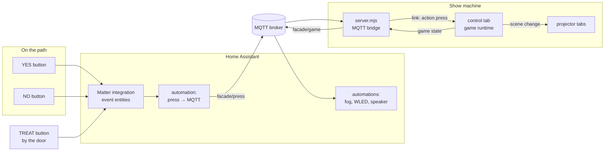
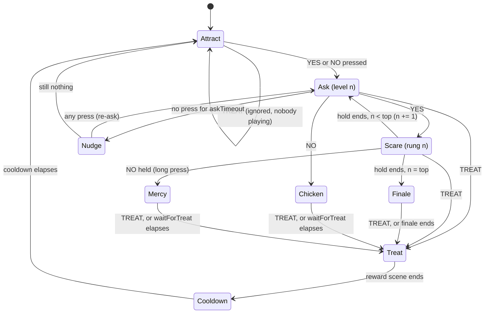
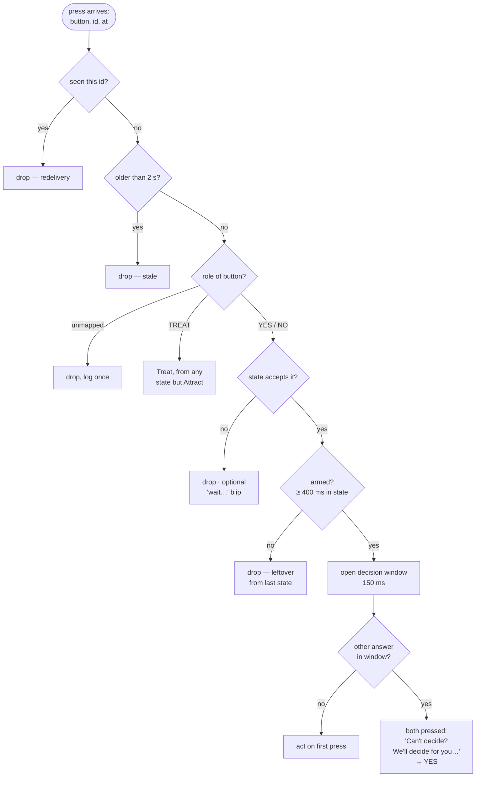
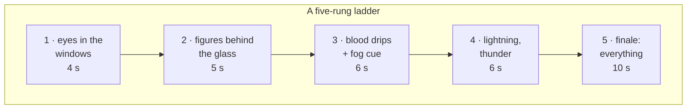

# Dare buttons — a proposal

> **Status: design, not built.** This is the approach for letting trick-or-treaters
> drive the show themselves from physical buttons, written down before any code
> so the interaction can be argued about while it is still cheap to change.

A trick-or-treater rings the bell and the house answers. Two big
buttons on the path: **YES** and **NO**. The facade asks *"Do you dare?"*.
Pressing YES gets them something scary, and then the house asks again with a
scarier one waiting. They keep going until they say NO, they reach the top of
the ladder, or the adult on the door decides they have earned it and presses
**TREAT**.

The buttons are Matter buttons in Home Assistant, and the house already has an
MQTT broker. Everything below is about getting a press from a child's thumb to
the wall in about a quarter of a second, and about what happens when four
children press everything at once.

- [The shape of it](#the-shape-of-it)
- [The game](#the-game)
- [Handling presses](#handling-presses)
- [Getting a press to the show](#getting-a-press-to-the-show)
- [Telling the rest of the house](#telling-the-rest-of-the-house)
- [Designing a ladder](#designing-a-ladder)
- [What it does to the rest of the show](#what-it-does-to-the-rest-of-the-show)
- [Building it](#building-it)
- [Open questions](#open-questions)

## The shape of it



The rule that holds the rest of the app together holds here too: **the control
tab is the only thing that decides anything.** Home Assistant reports that a
button was pressed. The server carries the message across and does not
interpret it. The game, meaning what that press means right now, runs in the
control tab, next to the triggers it already reuses. The result goes out the
same way every scene change already does.

Doing it this way has three consequences:

- A press from the phone remote and a press from a Matter button are the same
  message. You can rehearse the whole game indoors on a phone, without Home
  Assistant running.
- Home Assistant does not need to know what level the game is on, and nothing in
  its YAML has to change when you redesign the ladder.
- The server stays the "forward frames and tell the time" thing
  [multi-device](multi-device.md) describes. It gains a second kind of socket,
  but it still holds no state about the show.

## The game



| State | On the wall | Presses that count |
| --- | --- | --- |
| **Attract** | The ambient loop, plus a prompt: *"Press YES if you dare"* | YES or NO starts a game at level 1. Either button counts, because a child who pressed NO first still wants to see what happens. |
| **Ask** *n* | The question scene for level *n*. The wording gets worse as *n* rises: *"Scarier?"*, *"Are you SURE?"*, *"Last chance…"* | YES, NO, TREAT |
| **Scare** *n* | Rung *n* of the ladder: a scene, a sound, a hold | TREAT. A long press on NO also counts (see [Mercy](#mercy)). Everything else is dropped. |
| **Finale** | The top rung: the worst thing the house can do | TREAT |
| **Chicken** | A gentle send-off. NO at level 1 gets *"Wise choice"* and NO at level 4 gets *"So close!"*. Pick the scene from *n*. | TREAT |
| **Mercy** | The calm scene, straight away and with no sting | TREAT |
| **Treat** | The reward: *"You survived!"*, fireworks, whatever the house does for a happy ending | none |
| **Cooldown** | Back to ambient, with no prompt yet | none |

### Mercy

Some children are four. A long press on NO **during a scare** cuts the scare
short and goes straight to the calm scene. Without this, the only way out of
something that has gone too far is the adult reaching the laptop. Matter
buttons report `long_press` on their own, so this costs one extra event type in
the automation. A slow press of NO is also what a frightened child does
naturally, which is a better trigger than any instruction you could give them.

Mercy goes to **Treat** like every other ending. Nobody is sent away from the
door empty-handed for being scared.

### Why NO does not end the game

NO leads to **Chicken**, which waits for TREAT. The adult at the door is still
the one who decides when the visit is over. The house only stops escalating.
`waitForTreat` (default 20 s) is there in case nobody presses TREAT, because a
show stuck on *"So close!"* all evening is worse than one that resets.

## Handling presses

This is where the design needs to be careful. Buttons on a path get pressed by
groups, by mashing, by toddlers holding them down, and by the same child twice
because nothing seemed to happen. These are the rules, in the order the runtime
applies them:



1. **Deduplicate by id.** Each press carries the Home Assistant event's context
   id. MQTT at QoS 1 can deliver the same message twice after a reconnect, and
   the second copy would answer the *next* question.
2. **Drop stale presses.** Any press more than two seconds old is discarded,
   using link time just as scene stamps do. If the broker or the server
   restarts, it must not replay three minutes of presses into a fresh game.
   This is also why presses are **never published retained**: a retained press
   would be redelivered to the bridge every time it reconnects.
3. **Map buttons to roles, not devices.** The project stores
   `{ "button-id": "yes" | "no" | "treat" }`. Two YES buttons on two sides of
   the path is a mapping change, not a code change. A button you replace on
   the night gets mapped again from a list of the presses the control tab has
   recently seen.
4. **Drop, never queue.** A press that arrives during a scare does not answer
   the next question. Queued presses are how a group of mashers skips from level
   1 to level 4 without seeing anything in between. If you want feedback for a
   dropped press, it is a short sound from the control tab, not a change of state.
5. **Arm each question.** For the first 400 ms after a question appears, its
   own presses are ignored. Without this, the thumb still on YES from the last
   question answers the new one before anyone has read it.
6. **Give the other answer a chance.** The first accepted press opens a
   150 ms window. If the opposite answer arrives inside that window, two
   children disagreed. Instead of picking whichever packet won, the house says
   so: a "can't decide" sting, and then YES. Presses of the same button inside
   the window add nothing.
7. **TREAT always wins.** It skips the arming delay and the decision window
   and works in every state except Attract. An adult presses it once and means it.

Matter buttons send several events for one press (`initial_press`,
`short_release`, `long_press`, `multi_press_complete`…). **Use
`initial_press`** for YES, NO and TREAT. It is the earliest event, and it does
not wait for the multi-press detection window that `short_release` and
`multi_press_complete` wait for. That window adds several hundred milliseconds,
which a child notices. The one place a second event type is needed is
`long_press` on NO, for Mercy.

## Getting a press to the show

The broker speaks MQTT over TCP and the control tab is a web page, so something
has to sit between them. There are three places it could go:

| Option | For | Against |
| --- | --- | --- |
| **`server.mjs` subscribes to the broker** *(proposed)* | One socket, held by a process that does not stop when a tab is hidden or reloaded. It also publishes state back out. No changes to the broker. | A small MQTT client written by hand: CONNECT, SUBSCRIBE, PUBLISH at QoS 0/1, PING. That is about 150 lines, in the same spirit as the WebSocket code already in there. |
| The control tab connects over MQTT-over-WebSockets | Nothing to add to the server | The broker needs a WebSocket listener. The page needs an MQTT library, and this project has no dependencies. The socket dies when the control tab reloads mid-evening. |
| Home Assistant `rest_command` → `POST /link/press` | Smallest possible change, and no MQTT at all | Presses only go in. Telling Home Assistant the game state needs a second mechanism. It also bypasses the pub/sub server you already have. |

**Proposed: the server bridges, and `POST /link/press` comes along too.** The
HTTP endpoint is about twenty lines once the bridge exists, it is handy for
`curl` while testing, and it suits anyone without a broker.

```bash
node server.mjs --mqtt mqtt://homeassistant.local:1883 --mqtt-user facade --mqtt-pass …
```

The bridge turns `facade/press` into the link frame a remote already sends,
`{ type: 'action', action: 'press', button, id, at }`. To the control tab it is
a remote action like any other. The server never learns what YES means.

### The Home Assistant side

The automation is the same for every button and never needs to change:

```yaml
alias: Facade — button press to MQTT
mode: queued
triggers:
  - trigger: state
    entity_id:
      - event.path_button_left_button
      - event.path_button_right_button
      - event.door_button_button
actions:
  - condition: template
    value_template: >
      {{ trigger.to_state.attributes.event_type in ['initial_press', 'long_press'] }}
  - action: mqtt.publish
    data:
      topic: facade/press
      retain: false
      qos: 1
      payload: >
        {{ {
          "button": trigger.entity_id,
          "kind": trigger.to_state.attributes.event_type,
          "id": trigger.to_state.context.id,
          "at": (as_timestamp(trigger.to_state.last_changed) * 1000) | int
        } | tojson }}
```

The roles (`yes`, `no`, `treat`) are assigned in the control tab and not in
Home Assistant. That keeps the design of the game in one place.

## Telling the rest of the house

The game publishes two topics:

| Topic | Retained | Payload | For |
| --- | --- | --- | --- |
| `facade/game` | yes | `{ "state": "ask", "level": 2, "of": 5 }` | Dashboards, and an automation that lights the buttons only while a question is being asked |
| `facade/game/cue` | no | `{ "cue": "scare", "level": 3 }`, `{ "cue": "treat" }`… | Fog on rung 3, the gutter WLED going red, the doorbell chime on Treat |

The game state is retained because it is a statement of the current state, and
a dashboard that connects late should see it. Cues are not retained because they
are moments: replaying *fog on* to a reconnecting automation an hour later would
fill the street with fog.

Cues also make the existing per-trigger HTTP hooks optional for anyone running
Home Assistant. The fog machine is driven by an HA automation listening for
`level >= 3`, so it does not need a URL pasted into four separate triggers.
The hooks still work and still fire, so nothing set up for last year breaks.

## Designing a ladder

A game is a few scenes plus a list of rungs, and each rung is an existing
**trigger**. Triggers already bundle a scene, a sound, a hold and before/after
hooks. That is exactly what a scare is, and you already know how to build one.



Some guidelines that make it work on the night:

- **Make rung 1 gentle.** Some of the first group will be small, and they cannot
  unsee rung 4.
- **Escalate in more than one dimension.** Brighter and louder gets old fast.
  Escalating *closeness* works better: something in the window, then something
  at the door, then something that seems to come off the wall. So does adding
  *sound* partway up.
- **Hold each question for the same length of time.** Varying the scare holds
  is fine. Varying the question holds makes the game feel broken.
- **Write the ask scenes as a series.** The text effect does the words, and
  the [scene drift](effects.md#scenes-that-evolve-from-each-other) workflow
  makes *"Scarier?"*, *"Are you SURE?"* and *"LAST CHANCE"* quick to build
  as variations of each other.
- **Keep the ladder short.** Five rungs at about six seconds each, plus the
  questions, is already over a minute at the door. Queues form behind long games.

Proposed project shape (one game per show is enough, but an array costs
nothing and lets you keep a "little ones" ladder next to the full one):

```js
games: [{
  id, name, enabled,
  buttons: { 'event.path_button_left_button': 'yes', /* … */ },
  attractSceneId,            // the prompt over the ambient loop
  askSceneIds: [ … ],        // one per level, or one reused
  rungs: [ triggerId, … ],   // scare n is rung n
  chickenSceneIds: [ … ],    // by level, last one repeats
  mercySceneId, rewardSceneId, nudgeSceneId, decideSceneId,
  askTimeout: 15, waitForTreat: 20, cooldown: 6,
  armMs: 400, windowMs: 150, staleMs: 2000,
}]
```

## What it does to the rest of the show

- **While a game is running it owns the stage.** Playlist advancing, timer
  triggers and motion triggers are suspended from the first press to the end of
  Cooldown. Otherwise a timed lightning strike lands in the middle of
  *"Are you SURE?"* and the trigger's restore puts back a question that has
  already been answered. In Attract they run as normal, so the house still does
  its thing between visitors. A motion trigger on the path is a good way to
  draw people to the buttons.
- **Game scenes do not load onto the layers.** This is the same rule as
  triggers and the playlist, for the same reason: an evening of games must not
  rewrite the show.
- **Holds and timeouts use real timers, not the render loop.** This is the
  `armWake` lesson from triggers: a control tab behind another window still has
  to end a scare and still has to time out an unanswered question.
- **The remote gets the game.** A YES / NO / TREAT row on `remote.html` sends
  the same `press` action as the buttons, and works as a treat button for an
  adult who is not standing by the door. It also gets *reset game*, the one
  thing you want when a group walks off mid-ladder and the nudge has not
  caught up yet.

## Building it

In order, each step usable before the next:

1. **`js/control/game.js`**: the state machine as a pure function of
   `(state, press | tick, now)` with injected `cue` / `scene` / `publish`
   callbacks. Test it in `test/game.test.mjs` the way `triggers.test.mjs`
   tests holds: scripted press sequences against a fake clock, including the
   unfriendly ones. These include a press during a scare, YES and NO 40 ms apart,
   the same id twice, a press from five seconds ago, and TREAT in Attract.
2. **Extract `cue(trigger)` from `fire`** in `triggers.js`, covering the
   scene, sound and before hook without the hold-and-restore. The game needs a
   rung to play like a trigger but to return to *the next question*, not to
   whatever was on before. Triggers keep using `fire`, which calls `cue`.
3. **`press` remote verb + remote UI row.** At this point the game is playable
   from a phone with no Home Assistant at all. Do the design work on the
   ladder here.
4. **Schema + migration** in `state.js`, and a Game panel in the control tab
   with a button-learning list ("press the button you want to be YES").
5. **MQTT bridge in `server.mjs`** behind `--mqtt`, plus `POST /link/press`.
   Both are key-checked when `--key` is set, like the socket. Add tests in
   `link.test.mjs` for the MQTT framing, as for the WebSocket framing.
6. **State and cue publishing**, and a page in `docs/` with the HA automation
   above and a worked fog/WLED example.

## Open questions

- **How many buttons, and where?** Two on the path plus one by the door is
  assumed above. A single button (*press to dare*, and walking away means no)
  is a simpler game that needs only Attract → Scare → Ask with a timeout as the
  NO. It is worth considering if the second button might get lost or flattened.
- **Should the buttons light up?** If they have LEDs, or a WLED strip next to
  them, *lit only while a question is waiting* fixes the most common confusion
  (pressing during a scare) better than any rule above. It needs nothing from
  this app beyond `facade/game`.
- **Should the game ever reach Finale without an adult?** As written, the top
  rung plays and then the house waits for TREAT. An unattended house, or one
  that is out of sweets, may want Finale to go straight to a "come back next
  year" ending instead.
