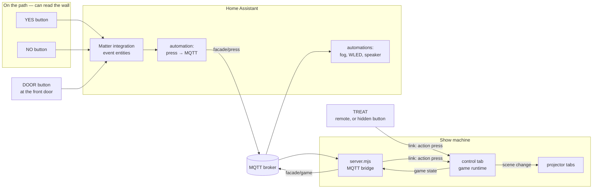
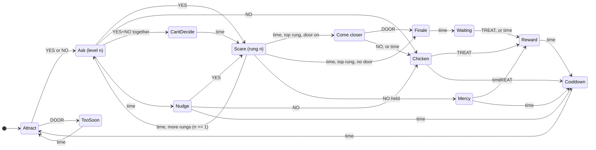
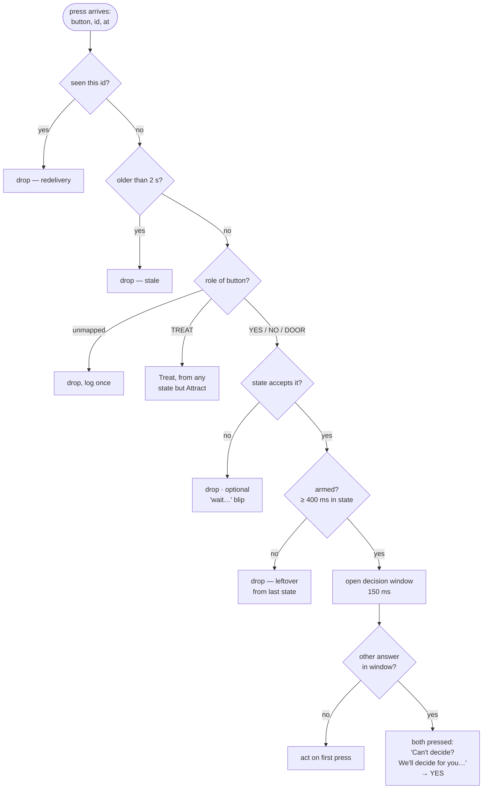
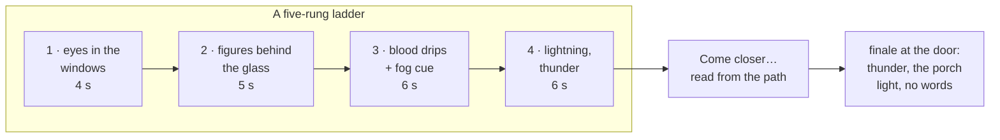

# Dare buttons

> **Status: built.** The state machine, its rules for presses, the diagram, the
> **Game** panel in the control tab, the **Game** tab on the remote, and the
> MQTT bridge that brings in presses from Home Assistant all work. See
> [connecting the buttons](#getting-a-press-to-the-show).

A group of trick-or-treaters comes up the path, and two big buttons are waiting
for them: **YES** and **NO**. The facade asks *"Do you dare?"*. YES gets them
something scary, and then the house asks again with a scarier one waiting. A
group that keeps saying YES reaches the top of the ladder, and the house invites
them up to the front door. There, a third button, **DOOR**, sets off the finale
over their heads. Saying NO at any point ends the escalation kindly. However it
ends, the adult with the sweets presses **TREAT**, and the group reads *"You
survived"* on the wall as they walk back down the path.

**Where people stand decides what goes on the wall.** The YES and NO buttons
sit far enough back that the whole facade is in view and words on it can be
read. That is where every question, every send-off and every scare with writing
in it belongs. At the door they are too close to read anything on the house, so
the finale is sound, light and something looming over them, not text. The
diagram colours each state by where its audience is standing. The reward is
written for the walk back, when they are far enough away again.

The buttons are Matter buttons in Home Assistant, and the house already has an
MQTT broker. Two or three buttons are enough: YES and NO on the path, and
optionally DOOR at the front door. Without a door button, the finale plays at the
top of the ladder where they stand. TREAT is for the adult. The remote has one,
or it can be a fourth button somewhere a child will not find it.

- [Trying it](#trying-it)
- [The shape of it](#the-shape-of-it)
- [The game](#the-game)
- [Handling presses](#handling-presses)
- [Getting a press to the show](#getting-a-press-to-the-show)
- [Telling the rest of the house](#telling-the-rest-of-the-house)
- [Designing a ladder](#designing-a-ladder)
- [What it does to the rest of the show](#what-it-does-to-the-rest-of-the-show)
- [Building it](#building-it)
- [Open questions](#open-questions)

## Trying it

1. Trace the house and tag the **wall**, the **door** and the **windows**. Tag a
   flat panel **primary** for the words, and the area just above a hanging
   basket or window box **planter** for flowers. No chimney needed: the smoke
   uses one if it is tagged and rises across the house if not.
2. Open the **Game** panel in the control tab and press **Build the example
   game**:

   | Moment | The house |
   | --- | --- |
   | Waiting for visitors | Brick, smoke, flowers in bloom. *DARE YOU? PRESS YES* |
   | YES | *SO… / YOU DARE.* — then question 1, *SOMETHING LIVES HERE. LOOK CLOSER?* |
   | YES | *YOU ASKED FOR IT…* — then blood down the door, and the flowers wilt and die |
   | Question 2 | Still bleeding, flowers dead. *IT'S BLEEDING. KEEP GOING?* |
   | YES | *DON'T SAY WE DIDN'T WARN YOU…* — then people at the windows, and lightning |
   | YES at question 3 | *TOO LATE / TO RUN…* — then tentacles through the brick |
   | Come to the door | All of it, the door glowing. *NOW… COME TO THE DOOR* |
   | The finale | Everything at once, eyes in every window, bats — no words |
   | Reward | *THE HOUSE LETS YOU GO…* — then candlelight, fireworks, *YOU SURVIVED!* |

3. Press **Open the game editor**. The whole game is a tree: each box is a
   moment, showing the words it puts on the wall, and each arrow is a press, or
   time running out. Click any moment and the side shows everything about it,
   in the order it happens:
   - **Words first**: lines said over whatever is already on the wall, one after
     another, each for a few seconds, and then the game moves on by itself,
     like a dare. Add, reword, retime or remove them. ▶ says one on the wall.
   - **Then it shows**: the scene, or for a scare its trigger and how long it
     lasts, the effects in it, and the words on the wall, editable in place.
     A new line is a new line on the wall.
   - **Then**: every way out of this moment (which press, or how long) and
     where each leads. Click one to go there.
4. Press **▶ Rehearse** and go outside. The laptop plays a brave group through
   the whole visit.
5. Run it from indoors with the remote's **Game** tab (`remote.html#game`).
   Turn on 🔔 **Sound**, ⚡ **Flash** and 📳 **Buzz** to be told every time the
   game moves on. When a group reaches the door you get a doorbell and a blue
   banner on the remote, whichever tab it is showing. That's the moment to get
   up with the sweets and press TREAT.

Everything the example makes is an ordinary layer, scene or trigger, named
`Dare · …`. The game's scenes are kept off the transport's scene buttons and the
remote's, because the game plays them and nobody should press them by hand.
**Rebuild the example**, at the bottom of the panel, puts it back how it started.

The tree is drawn from the same table the game runs on
([`js/core/game.js`](../js/core/game.js)), so an arrow on it is a move the game
will make, and a press with no arrow is a press the game will drop.

### How the flowers die

Two copies of the same bunch: one fresh, and one with its **Wilt** bound to the
expression `clamp(age / 6, 0, 1)`. `age` is the number of seconds since the
layer came on. Every scene up to the first scare shows the fresh copy, and every
scene from the scare on shows the dying one. So the moment the scare swaps them
is the moment they start to die, over six seconds, and they stay dead. The two
are identical at their first instant, so the swap itself cannot be seen. The
same trick, a binding on `age`, makes anything happen once, on cue, over
however long you like.

## The shape of it



The rule that holds the rest of the app together holds here too: **the control
tab is the only thing that decides anything.** Home Assistant reports that a
button was pressed. The server carries the message across and does not
interpret it. The game, meaning what that press means right now, runs in the
control tab, next to the triggers it already reuses. The result goes out the
same way every scene change already does.

Doing it this way has three consequences:

- A press from the phone remote and a press from a Matter button are the same
  message: `{ action: 'press', button, kind, id, at }`. You can rehearse the
  whole game indoors on a phone, without Home Assistant running.
- Home Assistant does not need to know what level the game is on, and nothing in
  its YAML has to change when you redesign the ladder.
- The server stays the "forward frames and tell the time" thing
  [multi-device](multi-device.md) describes. It has a second kind of socket
  now, but it still holds no state about the show beyond the last game state
  it republished.

## The game



TREAT goes to Reward from any state in which a group is playing. The control
tab draws this same diagram, live, from the table the game runs on. This copy
is for reading on GitHub.

| State | Where they are | On the wall | Presses that count |
| --- | --- | --- | --- |
| **Attract** | street | The house's normal show, or a prompt: *"Press YES if you dare"* | YES or NO starts a game at level 1. A child who pressed NO first still wants to see what happens. DOOR is **Too soon**. |
| **Too soon** | door | Somebody went straight to the door. A sound sends them back to the path. | none |
| **Ask** *n* | path | The question for level *n*. It gets worse as *n* rises: *"Scarier?"*, *"Are you SURE?"*, *"Last chance…"* | YES, NO, TREAT |
| **Anyone there?** | path | Nobody answered. One more chance before the house gives up on the group. | YES, NO, TREAT |
| **Can't decide** | path | YES and NO together. *"We'll decide for you…"*, then YES. | TREAT |
| **Scare** *n* | path | Rung *n* of the ladder: a trigger's scene, sound and hold | TREAT. NO held down is [Mercy](#mercy). Everything else is dropped. |
| **Come closer** | path | The top of the ladder: the invitation to the door. These are the last words they will read. | DOOR, NO, TREAT |
| **Finale** | door | Sound, light, something over their heads. No words. | TREAT |
| **Waiting** | door | They survived. The door opens. | TREAT. If nobody presses it, the reward plays anyway. |
| **Chicken** | path | A kind send-off, by level: NO at level 1 gets *"Wise choice"*, NO at level 4 gets *"So close!"* | TREAT |
| **Mercy** | path | Somewhere calm, straight away | TREAT |
| **Reward** | street | *"You survived!"*, written for the walk back down the path | none |
| **Cooldown** | street | Back to the house's normal show | none |

### Mercy

Some children are four. Holding NO down **during a scare** cuts the scare short
and goes straight to a calm scene. Without this, the only way out of something
that has gone too far is an adult reaching the laptop. Matter buttons report
`long_press` on their own, so this costs one extra event type in the automation.
A slow press of NO is also what a frightened child does naturally, which works
better than any instruction you could give them.

Mercy ends in the reward like every other ending. Nobody is sent away from the
door empty-handed for being scared.

### Why NO does not end the visit

NO leads to **Chicken**, which waits for TREAT. The adult at the door still
decides when the visit is over; the house only stops escalating. `waitForTreat`
(default 30 s) resets the house if nobody presses TREAT, because a show stuck on
*"So close!"* all evening is worse than one that resets.

A group that survived the finale is different. They are at the door, and it is
being opened. If nobody remembers TREAT, the reward plays anyway on the
`waitForTreat` timeout, so they still read *"You survived!"* on the way back.

## Handling presses

This is where the design needs to be careful. Buttons on a path get pressed by
groups, by mashing, by toddlers holding them down, and by the same child twice
because nothing seemed to happen. These are the rules, in the order the runtime
applies them:



1. **Deduplicate by id.** Each press carries the Home Assistant event's context
   id. MQTT at QoS 1 can deliver the same message twice after a reconnect, and
   the second copy would answer the *next* question.
2. **Drop stale presses.** Any press more than two seconds old is discarded,
   using link time just as scene stamps do. If the broker or the server
   restarts, it must not replay three minutes of presses into a fresh game.
   This is also why presses are **never published retained**: a retained press
   would be redelivered to the bridge every time it reconnects.
3. **Map buttons to roles, not devices.** The project stores
   `{ "button-id": "yes" | "no" | "door" | "treat" }`. Two YES buttons on two
   sides of the path is a mapping change, not a code change. A press that names
   a role directly, which is what the remote sends, needs no mapping at all. A
   button you replace on the night is mapped again from the Game panel, which
   lists every unknown button that has pressed recently with a role to give it.
4. **Drop, never queue.** A press that arrives during a scare does not answer
   the next question. Queued presses are how a group of mashers skips from level
   1 to level 4 without seeing anything in between. If you want feedback for a
   dropped press, it is a short sound from the control tab, not a change of state.
5. **Arm each question.** For the first 400 ms after a question appears, its
   own presses are ignored. Without this, the thumb still on YES from the last
   question answers the new one before anyone has read it.
6. **Give the other answer a chance.** In a question, the first accepted
   press opens a 150 ms window. If the opposite answer arrives inside that window, two
   children disagreed. Instead of picking whichever packet won, the house says
   so: a "can't decide" sting, and then YES. Presses of the same button inside
   the window add nothing.
7. **TREAT always wins.** It skips the arming delay and the decision window
   and works in every state except Attract. An adult presses it once and means it.

Matter buttons send several events for one press (`initial_press`,
`short_release`, `long_press`, `multi_press_complete`…). **Use
`initial_press`** for YES, NO and TREAT. It is the earliest event, and it does
not wait for the multi-press detection window that `short_release` and
`multi_press_complete` wait for. That window adds several hundred milliseconds,
which a child notices. The one place a second event type is needed is
`long_press` on NO, for Mercy. A long press on any other button is ignored,
because its `initial_press` has already counted.

## Getting a press to the show

The broker speaks MQTT over TCP, and the control tab is a web page, so the link
server holds the broker connection for it. It is the one process on the show
machine that stays up all evening, whether or not a tab is hidden or reloaded.

```bash
FACADE_MQTT_PASSWORD=… node server.mjs --mqtt mqtt://facade@homeassistant.local:1883
```

- `mqtt://` or `mqtts://` (TLS, port 8883 by default).
- Put the password in `FACADE_MQTT_PASSWORD` rather than in the URL. A URL on a
  command line can be seen by anyone on the machine who lists processes, and it
  ends up in shell history. The user can be in the URL or in
  `FACADE_MQTT_USERNAME`.
- `--mqtt-topic house/front` changes the prefix from `facade`.
- If the broker is not up yet, or goes away, the bridge keeps retrying, backing
  off to every 30 seconds, and says so in the terminal. A wrong password is
  reported as one and retried only slowly.

The bridge turns each message on `facade/press` into the same link frame the
remote's Game tab sends: `{ type: 'action', payload: { action: 'press', button,
kind, id, at } }`. To the control tab it is a remote action like any other. The
server never learns what YES means. Details, in
[`mqtt.mjs`](../mqtt.mjs):

- **Only `initial_press` and `long_press` count.** `short_release`,
  `long_release` and the multi-press events describe a press that has already
  been counted, so they are ignored.
- **Retained messages are never presses.** A retained press would start a game
  every time the server restarted. The terminal says so once if one turns up.
- **A clean session**, so a reconnect is not handed a backlog of presses.
- **Home Assistant's clock is not trusted.** It is a different machine, and a
  couple of seconds' disagreement would make every press look stale, or none.
  The bridge learns the gap the way the link learns a device's clock offset,
  from the fastest recent deliveries. It restamps each press in the server's
  time, so a press held up somewhere is still recognised as late.
- **No control tab, no game.** A press that reaches no control tab is logged:
  *"A button was pressed but no control tab is on the link to hear it."*

Not every press needs a broker. `POST /link/press` with `{"button": "yes"}`
does the same thing over plain HTTP, for Home Assistant's `rest_command` or for
`curl` while setting up. With `--key`, it needs `?key=` or an `X-Facade-Key`
header.

```bash
curl -X POST localhost:8000/link/press -d '{"button":"yes"}'
```

### The Home Assistant side

The automation is the same for every button and never needs to change:

```yaml
alias: Facade — button press to MQTT
mode: parallel
triggers:
  - trigger: state
    entity_id:
      - event.path_button_left_button
      - event.path_button_right_button
      - event.door_button_button
actions:
  - condition: template
    value_template: >
      {{ trigger.to_state.attributes.event_type in ['initial_press', 'long_press'] }}
  - action: mqtt.publish
    data:
      topic: facade/press
      retain: false
      qos: 1
      payload: >
        {{ {
          "button": trigger.entity_id,
          "kind": trigger.to_state.attributes.event_type,
          "id": trigger.to_state.context.id,
          "at": (as_timestamp(trigger.to_state.last_changed) * 1000) | int
        } | tojson }}
```

Then press each real button once. It appears in the Game panel under
**Buttons** as an unknown entity id, with YES / NO / DOOR / TREAT beside it.
The roles are assigned there rather than in Home Assistant, which keeps the
design of the game in one place.

For a button wired up by hand, `facade/press/<button>` works too, with the kind
as a bare word (`initial_press`, `long_press`) or no payload at all.

## Telling the rest of the house

The bridge reads the game's state from the digest the control tab already
publishes for remotes, and republishes it:

| Topic | Retained | Payload | For |
| --- | --- | --- | --- |
| `facade/game` | yes | `{"enabled":true,"state":"ask","level":2,"of":4,"zone":"path","active":true,"door":true}` | Dashboards, and lighting the buttons only while a question is waiting |
| `facade/game/cue` | no | `{"cue":"scare","level":3,"from":"ask","on":"yes"}` | Fog on rung 3, the gutter WLED going red, the doorbell chime on `reward` |
| `facade/bridge` | yes | `online` / `offline` | Whether the show machine is listening. The broker sends `offline` on its own if the server dies. |

The game state is retained because it is a statement of the current state, and
a dashboard that connects late should see it. Cues are not retained because they
are moments: replaying *fog on* to a reconnecting automation an hour later would
fill the street with fog.

```yaml
alias: Facade — fog on the third rung
triggers:
  - trigger: mqtt
    topic: facade/game/cue
conditions:
  - condition: template
    value_template: "{{ trigger.payload_json.cue == 'scare' and trigger.payload_json.level >= 3 }}"
actions:
  - action: switch.turn_on
    target: { entity_id: switch.fog_machine }
  - delay: { seconds: 4 }
  - action: switch.turn_off
    target: { entity_id: switch.fog_machine }
```

Cues make the existing per-trigger HTTP hooks optional for anyone running Home
Assistant. The hooks still work and still fire, so nothing set up for last year
breaks.

## Designing a ladder

A game is a few scenes plus a list of rungs, and each rung is an existing
**trigger**. Triggers already bundle a scene, a sound, a hold and before/after
hooks. That is exactly what a scare is, and you already know how to build one.



Some guidelines that make it work on the night:

- **Make rung 1 gentle.** Some of the first group will be small, and they cannot
  unsee rung 4.
- **Escalate in more than one dimension.** Brighter and louder gets old fast.
  Escalating *closeness* works better: something in the window, then something
  at the door, then something that seems to come off the wall. So does adding
  *sound* partway up.
- **Hold each question for the same length of time.** Varying the scare holds
  is fine. Varying the question holds makes the game feel broken.
- **Write the ask scenes as a series.** The text effect does the words, and
  the [scene drift](effects.md#scenes-that-evolve-from-each-other) workflow
  makes *"Scarier?"*, *"Are you SURE?"* and *"LAST CHANCE"* quick to build
  as variations of each other.
- **Keep the ladder short.** Five rungs at about six seconds each, plus the
  questions, is already over a minute at the door. Queues form behind long games.

- **Put the words where they can be read.** Questions, *"Come closer…"* and
  the send-offs are read from the path. The finale is not read at all, and the
  reward is read on the way back.

What a show stores (`project.game`; see `createGame` in
[`state.js`](../js/core/state.js)):

```js
game: {
  enabled: false,
  buttons: { 'event.path_button_left_button': 'yes', /* … */ },
  door: true,                       // end at the front door
  scenes: {
    attract, early, nudge, decide, approach, mercy, waiting, reward,  // scene ids
    ask: [ … ], chicken: [ … ],     // by level; a blank repeats the one before
  },
  rungs: [ triggerId, … ],          // scare n is rung n
  finale: triggerId,
  timing: { askTimeout: 15, nudgeTimeout: 10, approachTimeout: 25, waitForTreat: 30,
            rewardHold: 8, cooldown: 6, armMs: 400, windowMs: 150, staleMs: 2000, … },
}
```

## What it does to the rest of the show

- **While a game is running it owns the stage.** Playlist advancing, timer
  triggers and motion triggers are suspended from the first press until the game
  is back in Attract. Timers that come due meanwhile are pushed on, not saved up,
  and the scene that was up before the game is put back at Cooldown. Otherwise a timed lightning strike lands in the middle of
  *"Are you SURE?"* and the trigger's restore puts back a question that has
  already been answered. In Attract they run as normal, so the house still does
  its thing between visitors. A motion trigger on the path is a good way to
  draw people to the buttons.
- **Game scenes do not load onto the layers.** This is the same rule as
  triggers and the playlist, for the same reason: an evening of games must not
  rewrite the show.
- **Holds and timeouts use real timers, not the render loop.** This is the
  `armWake` lesson from triggers: a control tab behind another window still has
  to end a scare and still has to time out an unanswered question.
- **The remote gets the game.** Its **Game** tab sends the same `press` action
  as the buttons, with an id and a timestamp, so it goes through the same rules.
  It works as the TREAT button for an adult at the door. It also has *Reset*,
  the one thing you want when a group walks off mid-ladder before the nudge has
  caught up.

## Building it

Done:

1. **The table** — [`js/core/game.js`](../js/core/game.js): states, transitions,
   guards and the press-to-role mapping, as data. Nothing there touches the
   DOM or the clock.
2. **The runtime** — [`js/control/game.js`](../js/control/game.js): walks the
   table and applies every press rule above. It acts on the show only through an
   `io` object it is given, so [`test/game.test.mjs`](../test/game.test.mjs)
   plays whole evenings against a clock moved by hand: a full ladder, NO at each
   level, mashing, both buttons at once, redelivered and stale presses, mercy,
   resets, late ticks from a hidden tab, and edits made mid-game.
3. **Rungs reuse triggers** — `cue` and `cueEnd` in
   [`triggers.js`](../js/control/triggers.js) play a trigger without its
   hold-and-restore. While a game is playing, timer and motion triggers measure
   but do not fire, the playlist waits, and a scare caught mid-hold is finished
   with its `after` hook.
4. **The diagram** — [`js/core/gameGraph.js`](../js/core/gameGraph.js): the table
   drawn as SVG, laid out by hand from the street on the left to the door on the
   right, and lit up live.
5. **The Game panel** in the control tab and the **Game tab** on the remote:
   YES / NO (hold for mercy) / DOOR / TREAT, reset, the diagram, the press log,
   and learning which physical button is which from the presses that arrive.

6. **The MQTT bridge** — [`mqtt.mjs`](../mqtt.mjs), started by `--mqtt` on
   the link server, plus `POST /link/press`. MQTT 3.1.1 written by hand, like
   the WebSocket, so there is still nothing to install.
   [`test/mqtt.test.mjs`](../test/mqtt.test.mjs) checks the packets byte by byte,
   then runs the whole path against a small broker written in the test, through
   the real link server, to a WebSocket standing in for the control tab. It
   covers presses in, game state out, reconnecting, a wrong password and the
   HTTP endpoint. It has also been run against Mosquitto and the real control
   tab.

## Open questions

- **Should the buttons light up?** If they have LEDs, or a WLED strip next to
  them, lighting them only while a question is waiting would prevent the most
  common confusion (pressing during a scare) better than any rule above. It
  needs nothing from this app beyond `facade/game`.
- **Should the game ever reach the finale without an adult?** As built, the
  finale plays and the house waits a while for TREAT before showing the reward
  anyway. A house that is unattended, or out of sweets, may want a "come back
  next year" ending instead.
